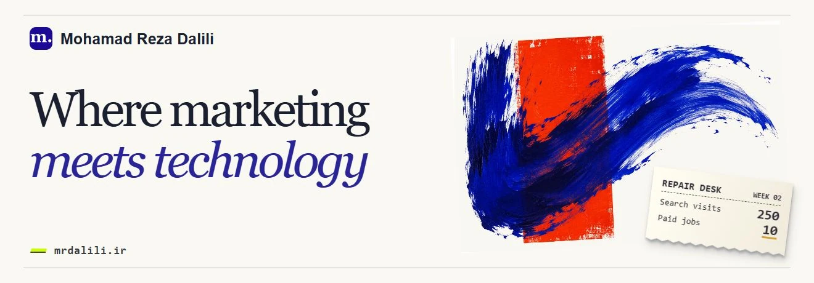
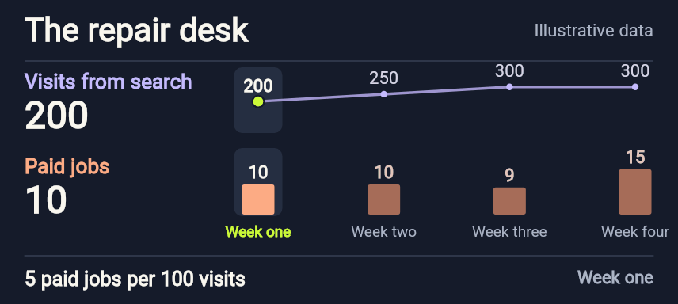
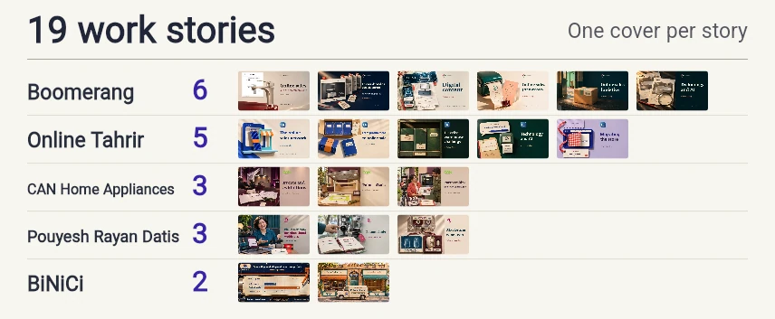

# Mohamad Reza Dalili’s personal website

[Visit the site](https://mrdalili.ir/?lang=en) · [Work stories](https://mrdalili.ir/work-stories.html?lang=en) · [CV](https://mrdalili.ir/profile.html?lang=en) · [فارسی](README.md)

<a href="https://mrdalili.ir/?lang=en"><picture>
  <source media="(prefers-color-scheme: dark)" srcset="docs/readme/cover-en-dark.webp">
  
</picture></a>

I work in marketing and use AI in my day-to-day work. I write about decisions I’ve had to make while building online sales channels. In the blog, you can work through the numbers and see whether you reach the same conclusion.

<a href="https://mrdalili.ir/strategy.html?lang=en"><picture><source media="(prefers-reduced-motion: reduce)" srcset="docs/readme/folder-strategy-en-still.webp"></picture></a>
<a href="https://mrdalili.ir/execution.html?lang=en"><picture><source media="(prefers-reduced-motion: reduce)" srcset="docs/readme/folder-execution-en-still.webp"></picture></a>
<a href="https://mrdalili.ir/technology.html?lang=en"><picture><source media="(prefers-reduced-motion: reduce)" srcset="docs/readme/folder-technology-en-still.webp"></picture></a>
<a href="https://mrdalili.ir/ai-tools.html?lang=en"><picture><source media="(prefers-reduced-motion: reduce)" srcset="docs/readme/folder-ai-tools-en-still.webp"></picture></a>

## More visits. More sales?

In this exercise, an espresso machine repair shop got **200 visits** from search in its first week and **250** in its second. Would you tell the owner that business had picked up?

<a href="https://mrdalili.ir/article.html?post=search-to-sale&amp;lang=en#orders"><picture>
  <source media="(prefers-reduced-motion: reduce) and (max-width: 620px)" srcset="docs/readme/repair-trends-en-mobile-still.webp">
  <source media="(prefers-reduced-motion: reduce)" srcset="docs/readme/repair-trends-en-still.webp">
  <source media="(max-width: 620px)" srcset="docs/readme/repair-trends-en-mobile.gif">
  
</picture></a>

<strong>See how the first two weeks compare</strong>

The shop booked **10 paid jobs in each week**. Five out of every 100 visits became paid jobs in week one; four did in week two.

[Try all four weeks in the live chart](https://mrdalili.ir/article.html?post=search-to-sale&lang=en#orders) · [Find its data in the source](public/posts/search-to-sale.mjs)

## Boomerang’s four-language catalogue for international buyers

In Boomerang’s online store, a customer picks a model and pays. An overseas buyer has a different question: “What would you quote for this many units, shipped here?” We put a **quote form** beside the product. I wrote about why we kept the catalogue separate from the shop, and why I kept its Persian pages out of search results.

[Visit the Boomerang catalogue](https://www.boomerang-co.com/en/) · [Read the Boomerang story](https://mrdalili.ir/reading/en/boomerang-four-languages.html) · [Browse the blog](https://mrdalili.ir/blog.html?lang=en)

<a href="https://mrdalili.ir/work-stories.html?lang=en"><picture>
  <source media="(max-width: 620px)" srcset="docs/readme/work-stories-en-mobile.webp">
  
</picture></a>

**My website: [mrdalili.ir](https://mrdalili.ir/?lang=en)**
