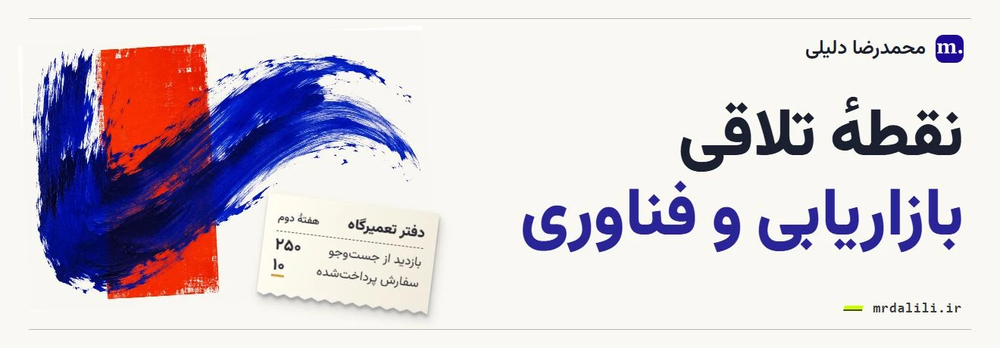
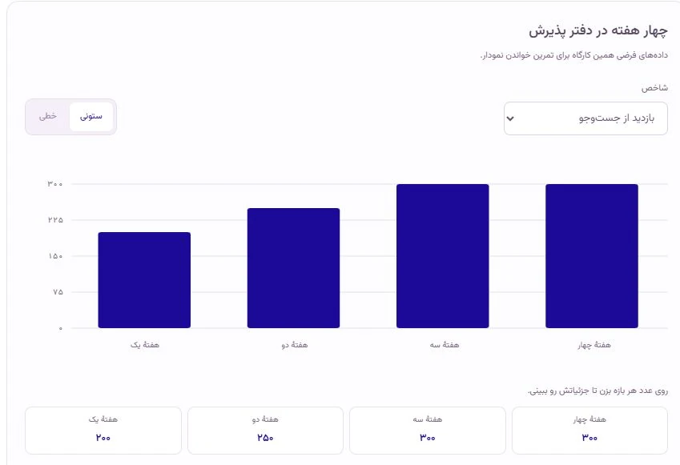

# خانهٔ دیجیتال محمدرضا دلیلی

[دیدن سایت](https://mrdalili.ir/?lang=fa) · [روایت‌های کاری](https://mrdalili.ir/work-stories.html?lang=fa) · [رزومه](https://mrdalili.ir/profile.html?lang=fa) · [English](README.en.md)

<a href="https://mrdalili.ir/?lang=fa"><picture>
  <source media="(prefers-color-scheme: dark)" srcset="docs/readme/cover-fa-dark.webp">
  
</picture></a>

من مارکتر و اپراتور هوش مصنوعی‌ام. در این سایت از تصمیم‌هایی می‌نویسم که موقع راه‌اندازی فروش آنلاین گرفته‌ام. در بلاگ هم می‌توانی خودت با عددها کار کنی و ببینی به چه نتیجه‌ای می‌رسی.

## بازدید بیشتر شد. سفارش هم؟

یک تعمیرگاه قهوه‌ساز هفتهٔ اول **۲۰۰ بازدید** از جست‌وجو داشت و هفتهٔ دوم **۲۵۰ بازدید**. اگر فقط همین را می‌دانستی، می‌گفتی فروش هم بهتر شده؟

<strong>دفتر سفارش‌های تعمیرگاه را باز کن</strong>

هر هفته **۱۰ سفارش پرداخت‌شده** ثبت شد. یعنی از هر ۱۰۰ بازدید، هفتهٔ اول ۵ تا و هفتهٔ دوم ۴ تا به سفارش رسید. این‌ها عددهای تمرینی مقاله‌اند.

<a href="https://mrdalili.ir/article.html?post=search-to-sale&amp;lang=fa#orders"><picture>
  <source media="(prefers-reduced-motion: reduce)" srcset="docs/readme/repair-desk-fa-still.webp">
  
</picture></a>

[با نمودار چهار هفته کار کن](https://mrdalili.ir/article.html?post=search-to-sale&lang=fa#orders) · [داده‌های همین نمودار در مخزن](public/posts/search-to-sale.mjs)

## چرا سایت چهارزبانهٔ بومرنگ دکمهٔ خرید ندارد؟

در فروشگاه بومرنگ، مشتری مدلش را انتخاب می‌کند و پولش را می‌دهد. خریدار خارجی سؤال دیگری دارد: «از این مدل، با این تعداد و برای این مقصد، چه قیمتی می‌دهید؟» برای همین در سایت چهارزبانه کنار محصول **فرم استعلام** گذاشتیم. در روایت این پروژه نوشته‌ام چرا دو سایت را جدا کردیم و چرا نخواستم نسخهٔ فارسی کاتالوگ در گوگل با فروشگاه رقابت کند.

[خواندن روایت بومرنگ](https://mrdalili.ir/reading/fa/boomerang-four-languages.html) · [بقیهٔ نوشته‌ها](https://mrdalili.ir/blog.html?lang=fa)

## اجرای سایت روی سیستم خودت

از ریشهٔ مخزن، با پایتون ۳:

~~~sh
python -m http.server 8080 --bind 127.0.0.1 --directory public
~~~

[پیش‌نمایش فارسی](http://127.0.0.1:8080/) · [پیش‌نمایش انگلیسی](http://127.0.0.1:8080/index.en.html) · [راهنمای فایل‌های پروژه](docs/repository-layout.md) · [ساخت مقالهٔ تعاملی](docs/interactive-blog.md)

